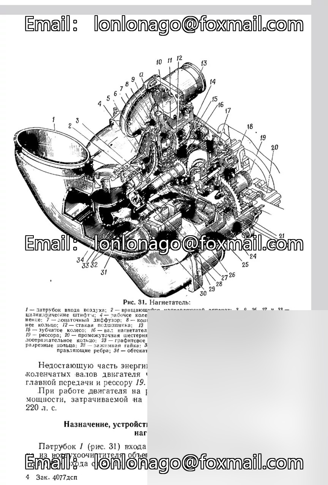
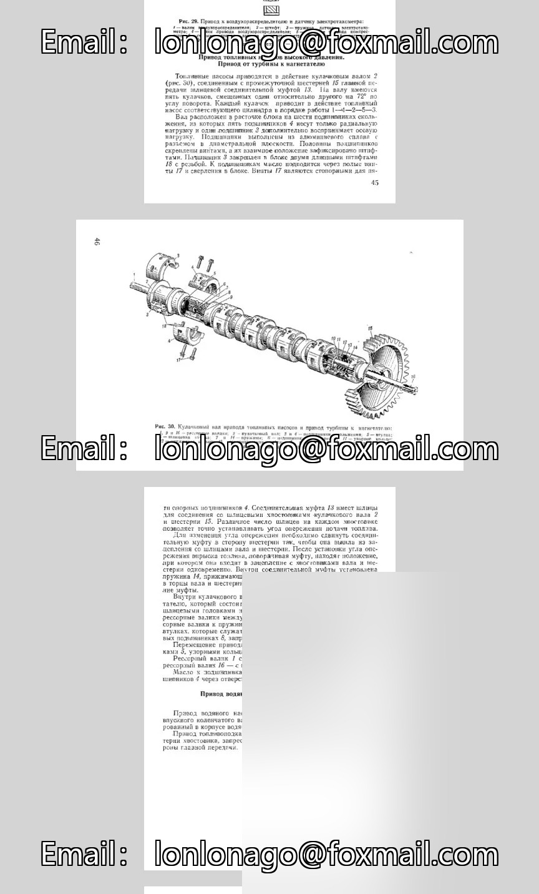
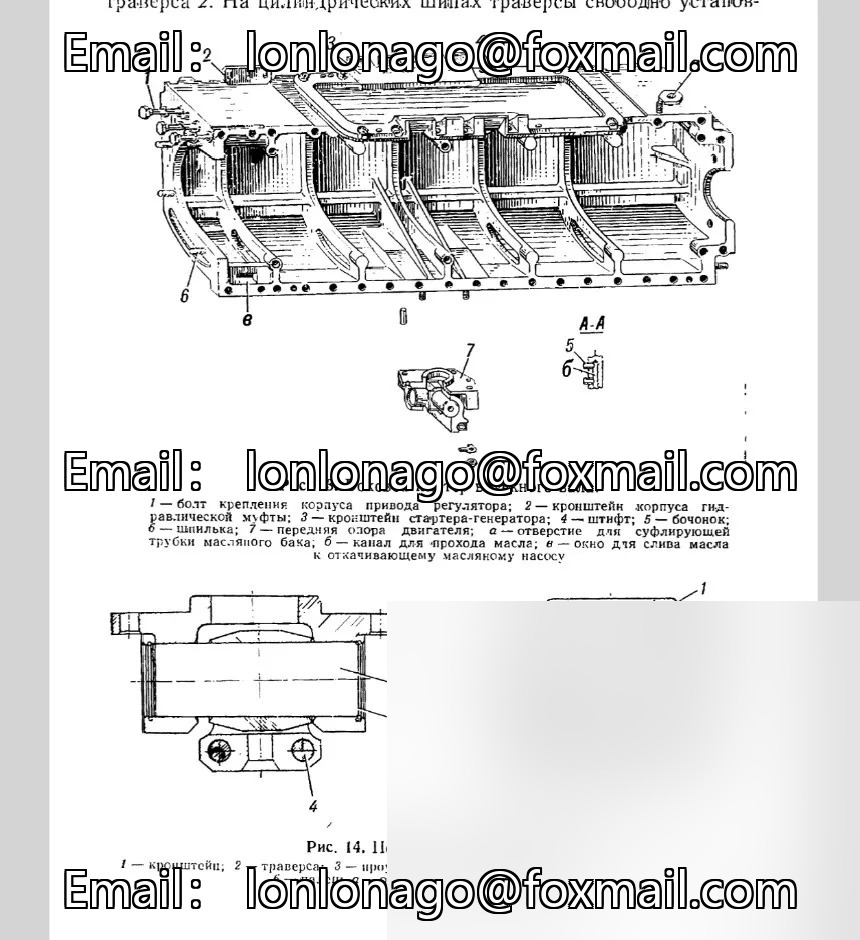
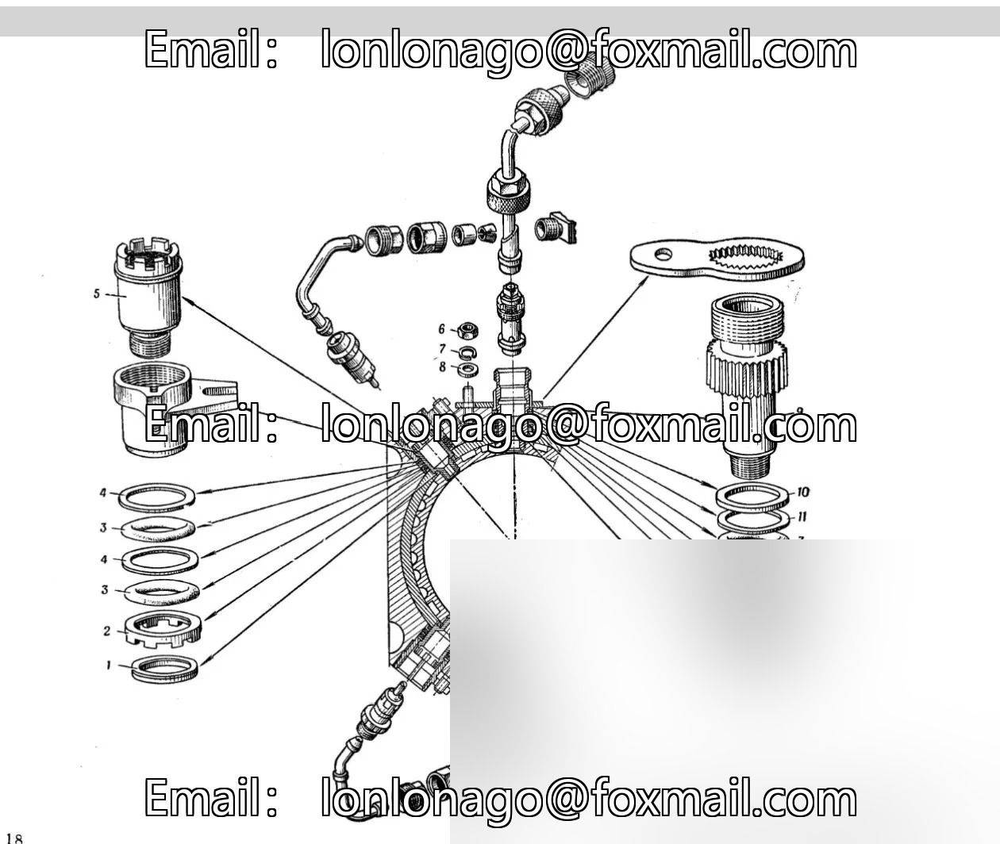
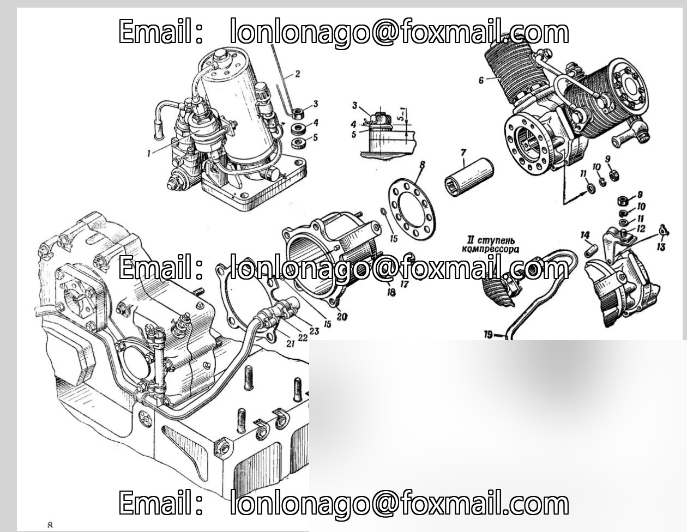
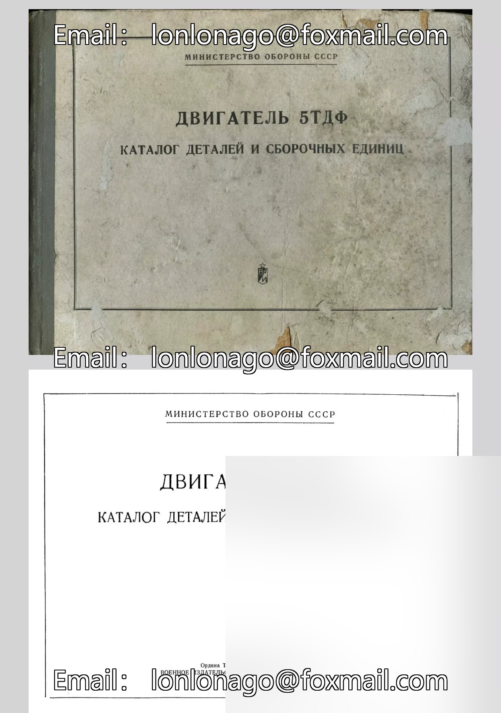

# Soviet 5TDF engine parts and assembly units catalog (binding book) and technical specification, cold

## Body

Catalog of Soviet 5TDF engine parts and assembly units (drawing book) and technical manual, advanced product of Soviet tank industry during the Cold War, the core power of T-64 main combat tank.
return no matter what is sold.
The 5TDF engine is an advanced product of Soviet tank industry during the Cold War, with high engineering research value.
​Applicable models: It is the heart of T-64 series main combat tanks (especially T-64A and T-64B).
​Technical characteristics:
​Opposite piston design: Using 5-cylinder, 10 piston, two-stroke, opposite piston liquid cooling design.
​Compact structure: This structure allows the engine to be very small in volume (extremely low height), thus achieving the very low profile of T-64 tanks.

High power-to-weight ratio: In the 1970s, its power (about 700 horsepower) was extremely remarkable relative to its small volume.
​Historical significance: The T-64 was the Soviet's first "three-generation tank," which at the time was considered a top-secret equipment, only deployed by elite forces.

This catalogue covers the parts and assembly units of the Soviet 5TDF engine, including figures and technical manuals for Cold War Soviet tank industrial advanced products; the image also contains specific catalog numbering and technical parameter entries.

<!-- AI_ENRICHED -->

## Images

## Payment

Here is a pay link on Stripe ( https://buy.stripe.com/3cs8yP7sY87d0vu9AB ). Please contact me lonlonago@foxmail.com after funding $89, and I will send you a complete data files , thank you!

